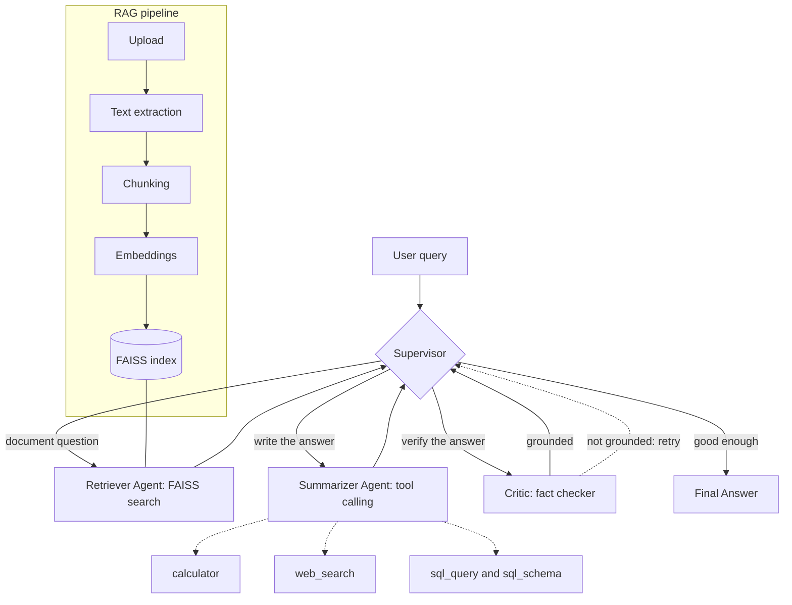

# DocuAgent — Multi-Agent Document Intelligence System

> A small, readable reference implementation of agentic AI fundamentals: a **LangGraph** supervisor routing work between a retriever, a summarizer and a fact-checking critic, with **real LLM tool calling** (calculator, web search, SQL) on top of a **RAG** pipeline over your own documents.

**Status: MVP / In Development** — runs locally end to end, with a FastAPI backend, a Streamlit UI, and a test suite that needs no API key.

---

## Overview

Asking questions about a pile of documents usually means one of two bad options: a single RAG chain that happily hallucinates, or a heavyweight agent framework you can't debug.

DocuAgent is the middle ground, built to be read in an afternoon:

- A **supervisor agent** decides *which specialist should act next* from the current task state, with deterministic guards so a weak or misbehaving model cannot send the graph into a loop.
- A **retriever agent** searches a local FAISS index built from your PDF, TXT and Markdown files, optionally scoped to a single document.
- A **summarizer agent** writes the answer with inline citations and **calls tools itself** when it needs arithmetic, the web, or the SQL database.
- A **critic agent** fact-checks the answer against the retrieved context and can **send the task back for another retrieval attempt** when it is not grounded (bounded to 1 retry by default).

It works with **OpenAI or any OpenAI-compatible endpoint** (Ollama, vLLM, Groq, Together, …), and it still boots and runs with **no API key at all** in an offline fallback mode.

---

## Architecture



<details>
<summary>Plain-text version (if the diagram does not render in your viewer)</summary>

```text
User query
    |
    v
Supervisor <------------------------------+
    |-- document question --> Retriever ---+   (FAISS search)
    |-- write the answer ----> Summarizer -+   (tools: calculator, web_search, sql_query, sql_schema)
    |-- verify the answer ---> Critic -----+   (not grounded -> back to Supervisor -> Retriever, bounded retry)
    '-- good enough ---------> Final Answer

RAG pipeline: Upload -> Text extraction -> Chunking -> Embeddings -> FAISS index -> Retriever
```

</details>

Every worker returns to the supervisor, which re-decides with fresh state.

### Supervisor routing policy

The supervisor returns JSON of the form `{"next": "retriever|summarizer|critic|final", "reason": "..."}`. The intended flow is:

| State | Next agent |
|---|---|
| No answer, no context, document question | `retriever` |
| Context available, no answer | `summarizer` |
| Answer + context, not yet checked | `critic` |
| Answer judged grounded | `final` |
| Answer rejected, more evidence could help | `retriever` (once, within the retry budget) |
| Answer rejected, more retrieval won't help | `summarizer` |
| Retry budget exhausted | `final` |

### Loop prevention

A deterministic sanitizer overrides invalid LLM decisions, so a small or unreliable model cannot stall the graph:

- A second retrieval is blocked while context exists but no answer does; the route becomes `summarizer`.
- Retrieval retries are allowed only after an answer exists **and** the critic asks for more context.
- The critic cannot run before an answer exists, and `final` cannot run without one.
- `MAX_RETRIES` bounds critic-to-retriever cycles; `MAX_STEPS` is a hard step limit for the whole graph.

---

## Features

| Area | What is implemented |
|---|---|
| **LangGraph orchestration** | `StateGraph` with supervisor, retriever, summarizer, critic and final nodes, conditional edges from the supervisor, shared `AgentState` TypedDict |
| **Supervisor agent** | LLM picks the next agent from a compact state digest; legality guard, loop prevention and a deterministic fallback router |
| **Retriever agent** | Deterministic (no LLM). Similarity search over FAISS; widens `k` and folds the critic's feedback into the query on a retry; supports `document_id` scoping |
| **Summarizer agent** | Writes answers with inline `[filename p.N]` citations; runs the tool-calling loop; extractive fallback when no LLM is configured |
| **Critic / fact checker** | Returns `{grounded, needs_more_context, missing, verdict}`; lexical-overlap fallback when no LLM is configured |
| **RAG** | PDF / TXT / MD → `pypdf` → recursive chunking → embeddings → FAISS (persisted to disk) → top-k retrieval with filename and page metadata |
| **Tool calling** | Real `bind_tools` loop: the model chooses the tool, results are fed back, loop capped at `MAX_TOOL_CALLS` |
| **Calculator** | AST-based safe evaluator (no `eval`): arithmetic plus `sqrt`, `log`, `round`, `min`, `max`, `sum`, `pi`, `e`, … |
| **Web search** | Tavily; explains exactly how to configure itself when the key is missing |
| **SQL** | Read-only `SELECT`/`WITH` over SQLite (`documents`, `document_metadata`, `sales`), single statement only, 50-row limit, plus a schema tool |
| **FastAPI** | `/health`, `/documents/upload`, `/documents`, `/chat`, with auto docs at `/docs` |
| **Streamlit** | Backend status, upload, document list, search-scope selector (all documents or one), chat with agent trace, tools used, fact-check panel and sources |
| **Offline fallback** | With no key or compatible base URL: hashing embeddings, rule-based routing, extractive answers, lexical critic |
| **Tests** | 40 pytest tests that run offline |

---

## Tech Stack

| Layer | Technology |
|---|---|
| Language | Python 3.10+ (tested on 3.12) |
| Orchestration | LangGraph |
| LLM plumbing | LangChain Core, `langchain-openai` (any OpenAI-compatible endpoint) |
| RAG | FAISS (`faiss-cpu`), `langchain-text-splitters`, `pypdf` |
| Backend | FastAPI + Uvicorn + Pydantic v2 |
| Frontend | Streamlit |
| Structured data | SQLite (stdlib `sqlite3`) |
| Web search | Tavily |
| Config | python-dotenv |
| Tests | pytest + FastAPI `TestClient` |

---

## Project Structure

```
Multi-Agent-Document-Intelligence-System/
├── app/
│   ├── agents/
│   │   ├── supervisor.py      # LLM router + legality guard + fallback router
│   │   ├── retriever.py       # vector search node (widens k on retry)
│   │   ├── summarizer.py      # answer writer + tool-calling loop
│   │   └── critic.py          # groundedness judge, asks for re-retrieval
│   ├── graph/
│   │   ├── state.py           # AgentState TypedDict shared by all nodes
│   │   └── workflow.py        # StateGraph wiring + run_query()
│   ├── tools/
│   │   ├── calculator.py      # safe AST evaluator
│   │   ├── web_search.py      # Tavily wrapper
│   │   ├── sql_tool.py        # read-only SQLite SELECT + schema tool
│   │   └── __init__.py        # TOOLS registry bound to the LLM
│   ├── rag/
│   │   ├── ingestion.py       # extract -> chunk -> Documents
│   │   ├── embeddings.py      # OpenAI-compatible embeddings / offline hashing fallback
│   │   └── retriever.py       # FAISS index: add / search / persist / reset
│   ├── api/
│   │   ├── routes.py          # the four endpoints
│   │   └── schemas.py         # Pydantic request/response models
│   ├── database/database.py   # schema, seed data, document bookkeeping
│   ├── config.py              # every env var in one place
│   ├── llm.py                 # LLM factory (returns None when unconfigured)
│   └── main.py                # FastAPI app + lifespan
├── frontend/streamlit_app.py  # the whole UI (HTTP client only, no agent logic)
├── scripts/create_sample_pdf.py
├── data/{documents,database,vectorstore}/   # runtime data, git-ignored
├── tests/                     # agents, graph, API, RAG, tools (40 tests, offline)
├── .env.example  requirements.txt  pytest.ini  README.md  RUN_LOCAL.md
```

---

## How It Works

A request flows like this:

1. `POST /chat {"query": "What does the document say about revenue?", "document_id": "optional"}`
2. `run_query()` builds a fresh `AgentState` and invokes the compiled graph.
3. **Supervisor** sees no context and routes to `retriever`.
4. **Retriever** runs a top-`k` FAISS search (restricted to `document_id` if given) and writes chunks with filename and page into `state["context"]`.
5. **Supervisor** sees context but no answer and routes to `summarizer`.
6. **Summarizer** answers from the context, citing `[report.pdf p.1]`. If the question needs maths, the database or the web, it calls `calculator`, `sql_query` or `web_search` and feeds the result back to itself.
7. **Supervisor** sees an unchecked answer and routes to `critic`.
8. **Critic** compares answer and context. If it returns `grounded: false` and asks for more context, the supervisor sends the task back to the **retriever**, which widens the search using the critic's `missing` hint, and the answer is rewritten once.
9. **Final** returns the answer plus the agent trace, tools used, sources, critique and retry count.

Example trace (offline fallback mode):

```
supervisor -> retriever | retriever (2 chunks, k=4) | supervisor -> summarizer
| summarizer | supervisor -> critic | critic (grounded) | supervisor -> final
```

### Document ingestion

- **Formats:** `.pdf`, `.txt`, `.md` (max 25 MB, empty files rejected).
- **PDF:** extracted page by page with `pypdf`, page numbers kept in metadata, unreadable pages skipped. No OCR, so scanned PDFs are rejected with a "no extractable text" error.
- **Chunking:** `RecursiveCharacterTextSplitter`, 1000 characters with 150 overlap by default.
- **Metadata per chunk:** `document_id`, `filename`, `page`, chunk index.
- **Persistence:** the FAISS index is saved to `data/vectorstore/faiss_index/` and document records to SQLite.

### Embeddings

- **With an API key:** `OpenAIEmbeddings` against OpenAI or any OpenAI-compatible provider via `OPENAI_BASE_URL`. OpenAI-specific tokenization checks are disabled for non-OpenAI providers such as Ollama and vLLM.
- **Without a key:** a deterministic 512-dimensional hashing vectorizer, so ingestion, retrieval and tests work offline. It matches words, not meaning.

> **Important:** if you change the embedding provider or model, delete `data/vectorstore/faiss_index/` and re-upload your documents. Vectors from different embedding setups are not compatible.

### API

| Method | Path | Purpose |
|---|---|---|
| `GET` | `/health` | Status, LLM/web-search configured flags, embeddings backend, indexed chunk and document counts, model name |
| `POST` | `/documents/upload` | Multipart PDF/TXT/MD → extract, chunk, embed, index |
| `GET` | `/documents` | List ingested documents with page and chunk counts |
| `POST` | `/chat` | Run the multi-agent workflow |

`POST /chat` request (`document_id` is optional; omit it to search all documents):

```json
{
  "query": "What does the report say about revenue?",
  "document_id": "abc123"
}
```

Response:

```json
{
  "answer": "...",
  "agents_used": [],
  "tools_used": [],
  "sources": [],
  "critique": {},
  "retries": 0
}
```

`GET /health` response:

```json
{
  "status": "ok",
  "llm_configured": true,
  "web_search_configured": false,
  "embeddings_backend": "openai-compatible",
  "indexed_chunks": 12,
  "documents": 2,
  "model": "gpt-4o-mini"
}
```

---

## Example Queries

```
Summarize the uploaded document.
What are the main points of section 2?
What does the document say about revenue?
Calculate the percentage increase between 34.0 and 42.5.
What is 25% of 840?
What is the total sales amount in the database?
How many documents were uploaded in the last month?
Search the web for recent news about LangGraph.
```

The first three go through retrieval; the middle ones make the model call `calculator` or `sql_query`; the last needs `TAVILY_API_KEY`.

---

## Local Setup

```bash
python -m venv .venv
source .venv/bin/activate          # Windows: .venv\Scripts\activate
pip install -r requirements.txt

cp .env.example .env               # add OPENAI_API_KEY (and TAVILY_API_KEY, optional)
python -m app.database.database    # create tables + seed sample sales data

uvicorn app.main:app --reload             # terminal 1 -> http://127.0.0.1:8000/docs
streamlit run frontend/streamlit_app.py   # terminal 2 -> http://localhost:8501
```

Want a document to try? Generate a small text-extractable PDF with no extra dependencies:

```bash
python scripts/create_sample_pdf.py        # writes data/documents/sample_report.pdf
```

Full step-by-step instructions, including troubleshooting: [**RUN_LOCAL.md**](RUN_LOCAL.md).

### Configuration

All settings are environment variables, centralized in `app/config.py`.

| Variable | Default | Purpose |
|---|---|---|
| `OPENAI_API_KEY` | *(empty)* | Enables the LLM and API embeddings when set; a compatible base URL also enables them |
| `OPENAI_BASE_URL` | *(OpenAI)* | Point at any OpenAI-compatible endpoint |
| `LLM_MODEL` | `gpt-4o-mini` | Chat model name |
| `LLM_TEMPERATURE` | `0` | Sampling temperature |
| `EMBEDDING_MODEL` | `text-embedding-3-small` | Embedding model name |
| `LLM_ENABLED` | *(unset)* | Optional `true`/`false` override; otherwise auto-detects a key or base URL |
| `CORS_ORIGINS` | `*` | Comma-separated allowed browser origins |
| `TAVILY_API_KEY` | *(empty)* | Enables the `web_search` tool |
| `CHUNK_SIZE` / `CHUNK_OVERLAP` | `1000` / `150` | Chunking |
| `TOP_K` | `4` | Chunks retrieved (doubled on a retry) |
| `MAX_RETRIES` | `1` | Critic-triggered re-retrievals |
| `MAX_STEPS` | `8` | Hard graph step limit |
| `MAX_TOOL_CALLS` | `3` | Tool-call rounds in the summarizer |
| `DATA_DIR` / `SQLITE_PATH` | `data/` / `data/database/docuagent.db` | Storage locations |
| `API_HOST` / `API_PORT` | `127.0.0.1` / `8000` | Backend bind address |
| `BACKEND_URL` | `http://127.0.0.1:8000` | Where the Streamlit app finds the API |

### Using a local model (Ollama, vLLM, …)

Any OpenAI-compatible server works. Example `.env` for Ollama:

```env
OPENAI_BASE_URL=http://localhost:11434/v1
LLM_MODEL=llama3.1:latest
EMBEDDING_MODEL=nomic-embed-text
```

No placeholder API key is required for local OpenAI-compatible servers. If you
change embedding provider or model, delete
`data/vectorstore/faiss_index/` and re-upload documents.

Pull the models first (`ollama pull llama3.1`, `ollama pull nomic-embed-text`). Smaller local models are less reliable at structured JSON routing and tool calling than hosted models, so expect to tune prompts or try a larger model. The supervisor's guards keep the graph terminating either way.

### Tests

```bash
pytest
```

The 40 tests run with no API key and cover graph compilation, supervisor routing and loop prevention, the full document workflow, critic-triggered retry, simulated tool calling, calculator and SQL safety, API endpoints, configuration, and invalid uploads.

---

## Limitations

**Retrieval**
- **One global FAISS index.** `document_id` filters results *after* the top-k search, so a scoped query can return fewer than `k` chunks (or none) if other documents dominate the top results.
- **No index management.** There is no document delete or re-index endpoint, and no check that the index matches the current embedding configuration.
- **Offline fallback is lexical, not semantic.** Hashing embeddings match words, not meaning, and the fallback critic is a word-overlap heuristic. They exist so the project runs without a key, not as a quality substitute.
- **No OCR**, reranking or hybrid search.

**Agents**
- **Citations are model-generated**, not programmatically verified against spans.
- **The critic is a single LLM judge** and can be wrong in both directions.
- **Chat is stateless.** There is no conversation memory between `/chat` calls.
- **Model dependence.** Supervisor JSON and tool calling depend on the model; supervisor and critic JSON is extracted from the first `{` to the last `}` rather than via structured output.
- **Hosted-model coverage is limited.** Test the LLM paths against your own provider and expect some prompt tuning.

**Security and operations (local development only)**
- No authentication, rate limiting or multi-user isolation.
- CORS allows all origins.
- SQL safety uses validation (SELECT/WITH only, single statement, keyword checks) rather than a read-only connection or table allowlist.
- The FAISS index is loaded with `allow_dangerous_deserialization=True`, which is only safe because the app writes the index itself. Never load an index from an untrusted source.
- Uploads, ingestion and chat run synchronously in the request; no background jobs or streaming.
- Files, SQLite and the vector index all live on local disk.
- `langchain-community` (used for the FAISS wrapper) is being sunset upstream; swapping in a direct `faiss` wrapper is a small, isolated change in `app/rag/retriever.py`.

---

## Roadmap

Not implemented yet. This is the intended direction, roughly in priority order.

**Correctness**
- Push the `document_id` filter into the FAISS search
- Embedding fingerprint stored with the index, with mismatch detection
- Document delete and re-index endpoints
- Structured output (JSON mode) for supervisor and critic
- Conversation memory / `session_id`
- Proper HTTP error codes from `/chat`

**Security**
- Authentication and per-user document isolation
- Configurable CORS origins
- Read-only SQL connection with a table allowlist and query timeout
- Rate limiting; content-based upload validation
- Prompt-injection hardening for untrusted document content

**Deployment**
- Dockerfiles and `docker-compose.yml`
- Persistent vector database (pgvector / Qdrant) and Postgres
- Object storage and background ingestion workers
- Streaming responses (SSE) through FastAPI and Streamlit
- Liveness/readiness health checks, reverse proxy with TLS
- CI/CD (lint, type-check, tests, image build)

**Quality**
- Better parsing (OCR, tables, layout-aware chunking), hybrid search, reranking
- Programmatic span-level citation verification
- Evaluation harness (RAGAS-style groundedness and relevance)
- Observability (LangSmith / Langfuse / OpenTelemetry), token and cost accounting
- Frontend tests

### Deployment options (future)

The app is a stateless FastAPI service plus a local data directory, so it ports easily: **Render** or **Railway** (one service for the API, one for Streamlit, a mounted volume for `data/`), **AWS** (ECS/Fargate + EFS or S3-backed index), **Azure** (Container Apps) or **GCP** (Cloud Run + Cloud Storage). Adding a Dockerfile is the first step.

---

## License

MIT — use it, fork it, rip the interesting parts out.
