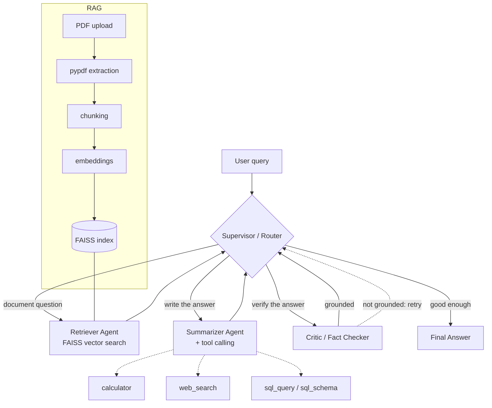

# DocuAgent — Multi-Agent Document Intelligence System

> A small, readable reference implementation of agentic AI fundamentals: a
> **LangGraph** supervisor routing work between a retriever, a summarizer and a
> fact-checking critic, with **real LLM tool calling** (calculator, web search,
> SQL) on top of a **RAG** pipeline over your own PDFs.

**Status: MVP / In Development**

---

## Overview

Asking questions about a pile of documents usually means one of two bad
options: a single RAG chain that happily hallucinates, or a heavyweight agent
framework you can't debug.

DocuAgent is the middle ground, built to be read in an afternoon:

- A **supervisor agent** decides *which specialist should act next* — it is an
  LLM decision over the current task state, not an `if/else` over keywords.
- A **retriever agent** searches a local FAISS index built from your PDFs.
- A **summarizer agent** writes the answer and **calls tools itself** when it
  needs arithmetic, the web, or the SQL database.
- A **critic agent** fact-checks that answer against the retrieved context and
  can **send the task back for another retrieval attempt** when it is not
  grounded (bounded to 1 retry by default).

Roughly 1,200 lines of Python, no class hierarchies, no Kubernetes.

---

## Architecture



Every worker returns to the supervisor, which re-decides with fresh state. Two
guards keep it terminating: a **retry budget** (`MAX_RETRIES`, default 1) and a
**hard step limit** (`MAX_STEPS`, default 8).

---

## Features

| Area | What is implemented |
|---|---|
| **LangGraph orchestration** | `StateGraph` with 5 nodes, conditional edges from the supervisor, shared `AgentState` TypedDict |
| **Supervisor agent** | LLM picks `retriever` / `summarizer` / `critic` / `final` from a JSON decision; legality guard + deterministic fallback router |
| **Retriever agent** | Similarity search over FAISS; widens `k` and folds the critic's feedback into the query on a retry |
| **Summarizer agent** | Writes grounded answers with inline `[file p.N]` citations; runs the tool-calling loop |
| **Critic / fact checker** | Judges groundedness, returns `{grounded, needs_more_context, missing, verdict}`, triggers re-retrieval |
| **RAG** | PDF/TXT/MD → pypdf → recursive chunking → embeddings → FAISS (persisted to disk) → top-k retrieval with page metadata |
| **Tool calling** | Real `bind_tools` calling — the model chooses the tool, results are fed back, loop capped at `MAX_TOOL_CALLS` |
| **Calculator** | AST-based safe evaluator (no `eval`), `sqrt/log/round/...` |
| **Web search** | Tavily; explains exactly how to configure itself when the key is missing |
| **SQL** | Read-only SELECT over SQLite (`documents`, `document_metadata`, `sales`) with a schema tool for the model |
| **FastAPI** | `/health`, `/documents/upload`, `/documents`, `/chat` + auto docs at `/docs` |
| **Streamlit** | Sidebar upload + document list + backend status; chat with sources, agent trace and fact-check panel |
| **Offline fallback** | With no API key the app still boots and runs: hashing embeddings, rule-based router, extractive answers, lexical critic |

---

## Tech Stack

| Layer | Technology |
|---|---|
| Language | Python 3.10+ (tested on 3.12) |
| Orchestration | LangGraph |
| LLM plumbing | LangChain Core, `langchain-openai` (any OpenAI-compatible endpoint) |
| RAG | FAISS (`faiss-cpu`), `langchain-text-splitters`, pypdf |
| Backend | FastAPI + Uvicorn + Pydantic v2 |
| Frontend | Streamlit |
| Structured data | SQLite (stdlib `sqlite3`) |
| Web search | Tavily |
| Config | python-dotenv |
| Tests | pytest + FastAPI `TestClient` |

---

## Project Structure

```text
docuagent/
├── app/
│   ├── agents/
│   │   ├── supervisor.py      # LLM router + legality guard + fallback router
│   │   ├── retriever.py       # vector search node (widens k on retry)
│   │   ├── summarizer.py      # answer writer + tool-calling loop
│   │   └── critic.py          # groundedness judge, asks for re-retrieval
│   ├── graph/
│   │   ├── state.py           # AgentState TypedDict shared by all nodes
│   │   └── workflow.py        # StateGraph wiring + run_query()
│   ├── tools/
│   │   ├── calculator.py      # safe AST evaluator
│   │   ├── web_search.py      # Tavily wrapper
│   │   ├── sql_tool.py        # read-only SQLite SELECT + schema tool
│   │   └── __init__.py        # TOOLS registry bound to the LLM
│   ├── rag/
│   │   ├── ingestion.py       # extract -> chunk -> Documents
│   │   ├── embeddings.py      # OpenAI embeddings / offline hashing fallback
│   │   └── retriever.py       # FAISS index: add / search / persist / reset
│   ├── api/
│   │   ├── routes.py          # the four endpoints
│   │   └── schemas.py         # Pydantic request/response models
│   ├── database/database.py   # schema, seed data, document bookkeeping
│   ├── config.py              # every env var in one place
│   ├── llm.py                 # LLM factory (returns None when unconfigured)
│   └── main.py                # FastAPI app factory + lifespan
├── frontend/streamlit_app.py  # the whole UI (HTTP client only, no agent logic)
├── scripts/create_sample_pdf.py
├── data/{documents,database,vectorstore}/
├── tests/                     # 35 tests, run offline without any API key
├── .env.example  requirements.txt  README.md  RUN_LOCAL.md
```

---

## How It Works

A request flows like this:

1. `POST /chat {"query": "What does the document say about revenue?"}`
2. `run_query()` builds a fresh `AgentState` and invokes the compiled graph.
3. **Supervisor** sees `context_chunks_retrieved: 0`, `documents_indexed: 12`
   and routes to `retriever`.
4. **Retriever** runs a top-4 FAISS search and writes the chunks (with filename
   and page) into `state["context"]`.
5. **Supervisor** sees context but no answer → routes to `summarizer`.
6. **Summarizer** answers from the context, citing `[report.pdf p.1]`. Had the
   question needed maths or the database, it would have called `calculator` or
   `sql_query` here and fed the result back to itself.
7. **Supervisor** sees an un-checked answer → routes to `critic`.
8. **Critic** compares answer and context. If it returns `grounded: false`, the
   supervisor sends the task back to the **retriever**, which widens the search
   using the critic's `missing` hint, and the answer is rewritten once.
9. **Final** returns the answer plus the agent trace, tool list, sources and the
   critic's verdict.

Actual trace from a local run (offline fallback mode):

```text
supervisor -> retriever | retriever (2 chunks, k=4) | supervisor -> summarizer
| summarizer | supervisor -> critic | critic (grounded) | supervisor -> final
```

### API

| Method | Path | Purpose |
|---|---|---|
| `GET` | `/health` | status, whether LLM/web search are configured, indexed chunk count |
| `POST` | `/documents/upload` | multipart PDF/TXT/MD → extract, chunk, embed, index |
| `GET` | `/documents` | list ingested documents with page/chunk counts |
| `POST` | `/chat` | run the multi-agent workflow; returns answer, agents, tools, sources, critique |

---

## Example Queries

```text
Summarize the uploaded document.
What are the main points of section 2?
What does the document say about revenue?
Calculate the percentage increase between 34.0 and 42.5.
What is 25% of 840?
What is the total sales amount in the database?
How many documents were uploaded in the last month?
Search the web for recent news about LangGraph.
```

The first three go through retrieval; the middle ones make the model call
`calculator` or `sql_query`; the last needs `TAVILY_API_KEY`.

---

## Current Status

**Status: MVP / In Development** — it runs locally, end to end, today.

- [x] LangGraph `StateGraph` with supervisor, retriever, summarizer, critic, final
- [x] LLM-driven routing with a legality guard and step limit
- [x] Critic-triggered re-retrieval (bounded retries, verified by a test)
- [x] RAG over PDF / TXT / MD with persisted FAISS index and page metadata
- [x] Real LLM tool calling (`bind_tools` loop, results fed back)
- [x] Calculator tool (safe AST evaluator)
- [x] SQL tool over SQLite with sample `sales` data + schema tool
- [x] Web search tool (Tavily) with graceful "not configured" behaviour
- [x] FastAPI: `/health`, `/documents/upload`, `/documents`, `/chat`
- [x] Streamlit UI: upload, document list, chat, sources, agent/tool trace
- [x] 35 pytest tests that pass with **no** API key
- [x] Offline fallback mode (hashing embeddings + rule-based router)
- [ ] Verified against a live OpenAI key (see Limitations)
- [ ] Streaming responses, auth, Docker, cloud deployment (see Roadmap)

---

## Limitations

- **Not verified against a live LLM API.** The build environment had no API key,
  so the LLM paths were validated with a scripted fake model (real tools really
  execute in those tests) rather than a live call. Expect prompt tuning.
- **No OCR.** Scanned/image-only PDFs produce no text and are rejected.
- **One global FAISS index** — all documents share it. `document_id` filters
  results *after* the search, so filtering can return fewer than `k` chunks.
- **Offline fallback is lexical, not semantic.** Hashing embeddings match words,
  not meaning; the fallback critic is a word-overlap heuristic. Both exist so the
  project runs without a key — not as a quality substitute.
- **Citations are model-generated**, not programmatically verified against spans.
- **No auth, no rate limiting, no multi-user isolation.** Local dev only.
- **Chat is stateless** — no conversation memory between `/chat` calls.
- **Critic is a single LLM judge**; it can be wrong in both directions.
- `langchain-community` (used for the FAISS wrapper) is being sunset upstream;
  swapping in a direct `faiss` wrapper is a small, isolated change in
  `app/rag/retriever.py`.

---

## Future Roadmap

Not implemented yet — this is the intended direction:

- Better document parsing (OCR, tables, layout-aware chunking)
- Multiple document collections / per-user namespaces
- Programmatic citation verification (span-level grounding)
- Persistent vector database (Chroma / pgvector / Qdrant)
- Authentication and per-user document isolation
- Streaming responses (SSE) through FastAPI and Streamlit
- More tools (charting, file export, internal APIs)
- Evaluation harness (RAGAS-style groundedness/answer-relevance scoring)
- Observability (LangSmith or OpenTelemetry traces, token/cost accounting)
- Docker + docker-compose
- Cloud deployment and CI/CD
- Production-grade MLOps (prompt versioning, regression suites, canary rollouts)

### Deployment options (future)

The app is a stateless FastAPI service plus a local data directory, so it ports
easily: **Render** or **Railway** (one service for the API, one for Streamlit,
a mounted volume for `data/`), or **AWS** (ECS/Fargate + EFS or S3-backed
index), **Azure** (Container Apps), **GCP** (Cloud Run + Cloud Storage). Adding
a Dockerfile is the first step and is deliberately left as an exercise so the
MVP stays minimal.

---

## Local Setup

```bash
python -m venv .venv
source .venv/bin/activate          # Windows: .venv\Scripts\activate
pip install -r requirements.txt

cp .env.example .env               # add OPENAI_API_KEY (and TAVILY_API_KEY)
python -m app.database.database    # create tables + seed sample sales data

uvicorn app.main:app --reload      # terminal 1 -> http://127.0.0.1:8000/docs
streamlit run frontend/streamlit_app.py   # terminal 2 -> http://localhost:8501
```

Full step-by-step instructions, including troubleshooting: **[RUN_LOCAL.md](RUN_LOCAL.md)**.

Run the tests (no API key needed):

```bash
pytest
```

---

## License

MIT — use it, fork it, rip the interesting parts out.
